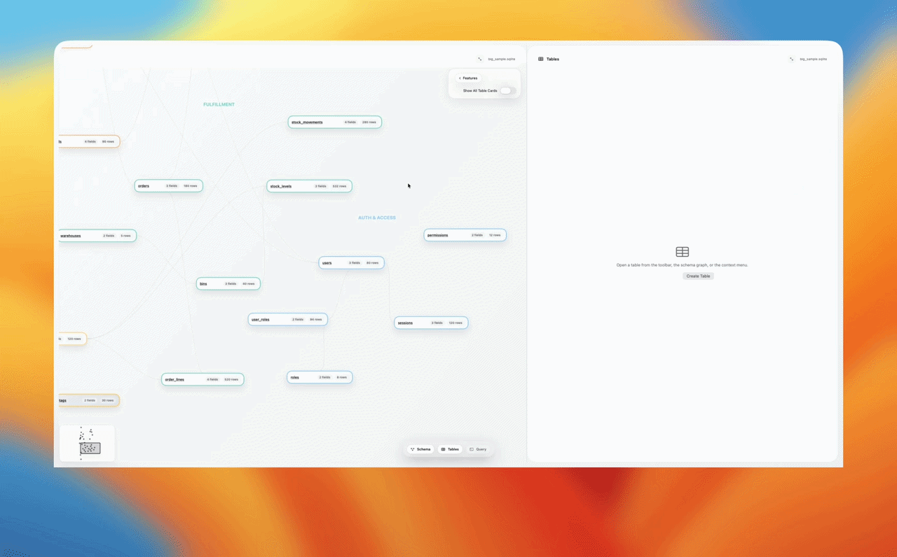

# SQLite Graph Studio



A native macOS database explorer for **SQLite and PostgreSQL**. Explore schemas as interactive graphs, browse rows, follow relationships, run queries, and export results.

[**Download the latest release**](../../releases/latest) · **macOS 15+**

Open the DMG, drag SQLite Graph Studio to Applications, and launch. No Xcode or Swift required.

## Supported databases

Choose **File → Choose file/folder…** (⌘O) or **Choose file/folder** on the welcome screen.

| Database | How to open it | Available operations |
| --- | --- | --- |
| **SQLite** | Select a local SQLite database file. | Browse, query, export, edit rows, and change schema. |
| **PostgreSQL** | Select a `.postgres` or `.pgstudio` JSON connection document, or a custom-format PostgreSQL backup. See [connection setup and backup requirements](docs/user-guide.md#postgresql-connections). | Read-only schema and row browsing, queries, relationship exploration, and exports. Backup opening requires a compatible local PostgreSQL runtime. |

For either engine, open versioned SQL migrations or a `schema.sql`/`structure.sql` file to explore a schema without a running database. These [migration models](docs/user-guide.md#migration-data-models) contain structure only, with no row browsing or query execution. Select a project folder to discover supported sources within it.

## Features

- **Schema graphs** — Explore foreign keys, search tables, and organise large models with groups and notes.
- **Data browsing** — Sort, filter, inspect records, and follow their relationships. Edit SQLite rows inline.
- **SQL and exports** — Run queries with explain plans, cancellation, and bounded results; export loaded or matching rows.
- **Flexible sources** — Open SQLite files, PostgreSQL connection documents or backups, or search an entire project folder.
- **Migration models** — Explore schemas from versioned SQL files and step through their history without a database server.

## AI coding agents

Connect Codex or Claude Code through **Coding Agents → Install local MCP and skills…** to explore schemas and show graphs and data inside supported chats. Review the setup, install, then restart your agent.

Or register both clients from Terminal after installing the app in `/Applications`:

```bash
"/Applications/SQLiteGraphStudio.app/Contents/MacOS/StudioMCP" setup all
```

Three included skills: [explore](Skills/database-explore/SKILL.md), [group tables](Skills/graph-clusters/SKILL.md), and [add descriptions](Skills/schema-descriptions/SKILL.md).

## Build from source

Requires Swift 6.3 and compatible Xcode.

```bash
git clone https://github.com/Albertsteenstrup/SQLiteGraphStudio.git
cd SQLiteGraphStudio
bash script/build_and_run.sh
```

## More

[User guide](docs/user-guide.md) · [Query and export contracts](docs/query-data-contracts.md) · [Record exploration](docs/record-exploration.md) · [Building and packaging](docs/packaging.md)

[Report an issue](../../issues) with your macOS version and steps to reproduce. [MIT license](LICENSE).
